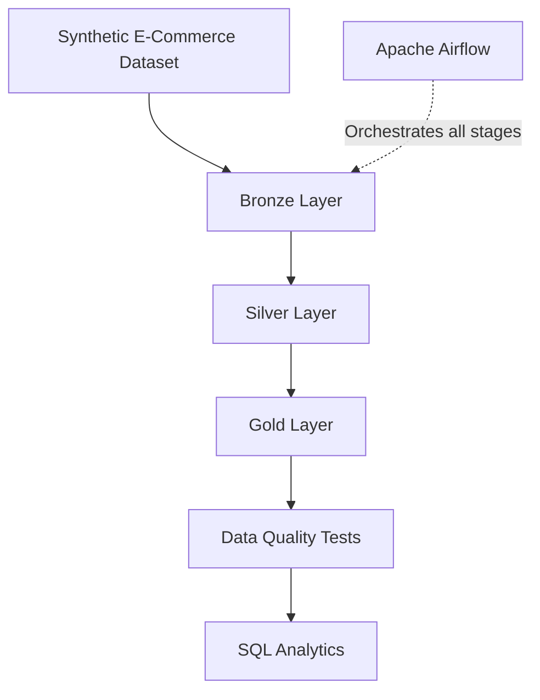

# End-to-End E-Commerce Data Engineering Pipeline

An end-to-end data engineering project that transforms 50,000 synthetic e-commerce transactions into analytics-ready dimensional data using **PySpark, Apache Airflow, DuckDB, and SQL**.

The project implements a structured Bronze–Silver–Gold data architecture, automated data quality validation, workflow orchestration, and analytical reporting.

## Project Overview

This pipeline demonstrates how raw transactional data can be ingested, validated, transformed, organized into a dimensional warehouse, and queried for business insights.

**Key capabilities**
- Automated generation of 50,000 synthetic e-commerce transactions.
- Bronze-layer ingestion with record validation and rejection handling.
- Silver-layer data cleaning and transformation using PySpark.
- Gold-layer dimensional modeling with fact and dimension tables.
- Apache Airflow orchestration using six sequential tasks.
- Automated data quality testing.
- SQL analytics using DuckDB.

## Architecture



### Medallion Architecture

| Layer | Description |
|---|---|
| Raw | Original generated e-commerce transactions |
| Bronze | Ingested records with validation and rejected-record handling |
| Silver | Cleaned and transformed transaction data |
| Gold | Analytics-ready fact and dimension tables |

### Gold Data Model

The Gold layer contains:

- `fact_sales` — 50,000 sales transaction records.
- `dim_customer` — 9,951 customer records.
- `dim_product` — 5,999 product records.
- `dim_date` — 731 date records.

## Technology Stack

| Technology | Purpose |
|---|---|
| Python | Pipeline development and orchestration scripts |
| PySpark | Distributed data transformation |
| Apache Airflow 3.4.0 | Workflow orchestration |
| DuckDB | Analytical SQL queries |
| SQL | Business analytics |
| Pandas / NumPy | Data processing and numerical operations |
| Git / GitHub | Version control and source code management |

## Airflow Workflow

The Airflow DAG is named `ecommerce_data_pipeline`.

It contains six sequential tasks:

1. `generate_dataset` — Generates the synthetic transaction dataset.
2. `bronze_ingestion` — Ingests and validates raw records.
3. `silver_transformation` — Cleans and transforms transaction data.
4. `gold_transformation` — Builds fact and dimension tables.
5. `data_quality_tests` — Executes automated validation tests.
6. `sql_analytics` — Executes analytical SQL queries.

All six tasks completed successfully in the verified Airflow run.

## Data Quality and Validation

The project includes automated tests covering:

- Duplicate dimension keys.
- Null fact-table keys.
- Duplicate order IDs.
- Valid transaction quantities.
- Valid revenue values.
- Valid order statuses.
- Fact-to-dimension referential integrity.

**Latest verified results:**
- 10/10 automated data quality tests passed.
- 0/10 tests failed.
- All 10 SQL analytics queries executed successfully.

## Business Analytics Results

The pipeline processes 50,000 transactions and produces the following analytical metrics.

| Metric | Result |
|---|---:|
| Total orders | 50,000 |
| Completed orders | 29,914 |
| Total units sold | 275,357 |
| Total recorded revenue | $60,651,808.80 |
| Completed revenue | $36,337,760.24 |
| Completed average order value | $1,214.74 |
| Average discount percentage | 10.03% |

Additional findings:
- Electronics generated the highest completed revenue among product categories.
- The Central region recorded the highest completed revenue among regions.

## Repository Structure

```text
cloud-data-pipeline-orchestration/
│
├── dags/
│   └── ecommerce_pipeline.py
│
├── scripts/
│   ├── generate_dataset.py
│   ├── ingestion.py
│   ├── silver_transformation.py
│   ├── gold_transformation.py
│   ├── query_analytics.py
│   └── run_pipeline.py
│
├── sql/
│   └── analytics.sql
│
├── tests/
│   └── test_gold_quality.py
│
├── data/                  # Generated locally; excluded from Git
├── requirements.txt
├── .gitignore
└── README.md
```

## Getting Started

### Prerequisites

- Python
- Java
- Apache Airflow (for workflow orchestration)
- Git

### 1. Clone the repository

```bash
git clone https://github.com/tanuja056/cloud-data-pipeline-orchestration.git

cd cloud-data-pipeline-orchestration
```

### 2. Create and activate a Python environment

```bash
python3 -m venv .venv

source .venv/bin/activate
```

### 3. Install project dependencies

```bash
pip install -r requirements.txt
```

### 4. Run the complete pipeline locally

```bash
python scripts/run_pipeline.py
```

This executes the data generation, ingestion, transformations, quality tests, and SQL analytics stages sequentially.

### 5. Run individual stages

```bash
python scripts/generate_dataset.py
python scripts/ingestion.py
python scripts/silver_transformation.py
python scripts/gold_transformation.py
python tests/test_gold_quality.py
python scripts/query_analytics.py
```

## Running with Apache Airflow

The project uses Apache Airflow 3.4.0 in a separate Python environment.

Configure the Airflow environment:

```bash
source .airflow_venv/bin/activate

export AIRFLOW_HOME="$HOME/airflow"

export AIRFLOW__CORE__DAGS_FOLDER="$PWD/dags"
```

Start Airflow:

```bash
airflow standalone
```

Open the Airflow interface:

```text
http://localhost:8080
```

Locate `ecommerce_data_pipeline`, enable the DAG if paused, and trigger it manually.

The DAG executes all six pipeline stages in sequence.

## Engineering Highlights

- Implemented a reproducible synthetic data generation process.
- Designed a multi-layer data processing architecture.
- Applied data validation and rejection handling during ingestion.
- Built dimensional fact and dimension tables.
- Developed automated data quality checks.
- Created analytical SQL queries for business reporting.
- Integrated pipeline scripts with Apache Airflow for task-level orchestration and monitoring.

## Project Scope and Limitations

This is a locally implemented portfolio project using synthetic e-commerce data.

Apache Airflow runs locally, and the data pipeline uses local storage. AWS or other cloud infrastructure has not been deployed as part of this implementation.

## Author

**Tanuja Kokkiligadda**

M.S. Data Science | University of Memphis

GitHub: [tanuja056](https://github.com/tanuja056)

LinkedIn: [tanuja-kokkiligadda](https://www.linkedin.com/in/tanuja-kokkiligadda/)
